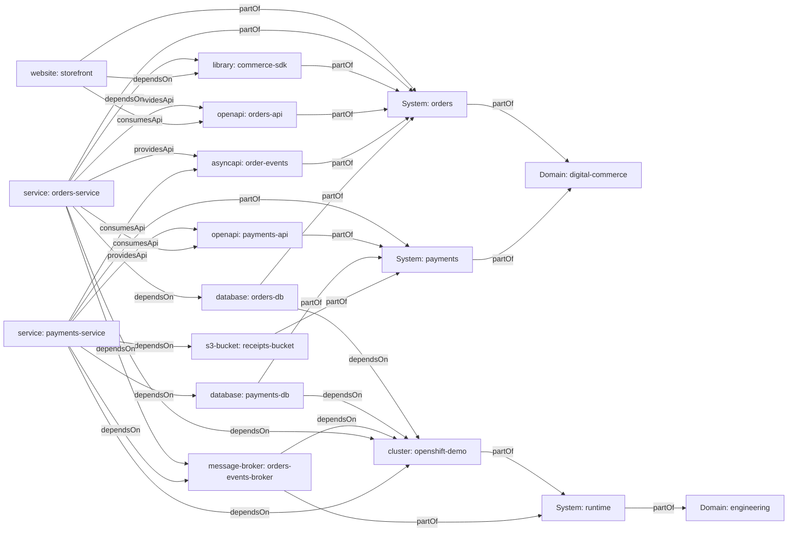
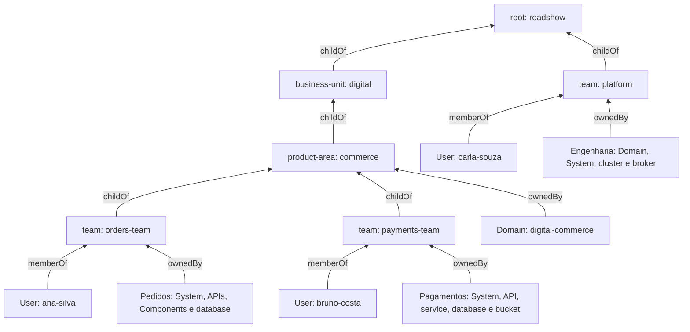

# Developer Hub Roadshow

Catálogo demonstrativo para **Red Hat Developer Hub (RHDH) / Backstage**, baseado no diagrama “What defines a software in Developer Hub”. O cenário fictício é uma loja digital: portal, pedidos, pagamentos e infraestrutura compartilhada. São **27 entidades em 7 arquivos**, registradas a partir de uma única `Location` raiz.

Este repositório descreve software e suas relações; não provisiona infraestrutura nem contém implementações executáveis dos serviços. Pessoas, infraestrutura e endereços `example.com` são fictícios. O ciclo de vida dos componentes e APIs é `experimental`.

## Organização do catálogo

| Arquivo | Entidades |
| --- | --- |
| `catalog-info.yaml` | Location raiz com seis targets relativos |
| `catalog/organization/catalog-info.yaml` | 6 Groups e 3 Users |
| `catalog/domains/catalog-info.yaml` | Comércio digital e engenharia de plataforma |
| `catalog/systems/catalog-info.yaml` | Pedidos, pagamentos e execução |
| `catalog/resources/catalog-info.yaml` | 2 databases, 1 s3-bucket, 1 cluster e 1 message-broker |
| `catalog/apis/catalog-info.yaml` | 2 OpenAPI 3.0.3 e 1 AsyncAPI 2.6.0 |
| `catalog/components/catalog-info.yaml` | 2 services, 1 website e 1 library |

Todas as entidades usam o namespace `default` e referências completas `kind:default/nome`. Os tipos de Resource, Component e Group são classificações de catálogo; não são instruções de provisionamento.

## Relações do diagrama

A hierarquia técnica é **Domain → System → Component / API / Resource**. A organização de pessoas é **Group → Group / User**. Um grupo é responsável por entidades via ownership; ele não é um contêiner técnico entre System e Component.

| Campo de origem | Relação gerada / inversa | Exemplo |
| --- | --- | --- |
| `System.spec.domain` | `partOf` / `hasPart` | orders → digital-commerce |
| `Component`, `API`, `Resource.spec.system` | `partOf` / `hasPart` | orders-service → orders |
| `spec.owner` | `ownedBy` / `ownerOf` | orders-service → orders-team |
| `Component.spec.dependsOn` | `dependsOn` / `dependencyOf` | orders-service → orders-db e commerce-sdk |
| `Resource.spec.dependsOn` | `dependsOn` / `dependencyOf` | orders-db → openshift-demo |
| `Component.spec.providesApis` | `providesApi` / `apiProvidedBy` | orders-service → orders-api |
| `Component.spec.consumesApis` | `consumesApi` / `apiConsumedBy` | payments-service → order-events |
| `Group.spec.parent` / `children` | `childOf` / `parentOf` | orders-team → commerce |
| `User.spec.memberOf` / `Group.spec.members` | `memberOf` / `hasMember` | ana-silva → orders-team |

O backend gera `relations`; os YAMLs não as escrevem manualmente. A associação ao domínio ocorre pelo System, sem um `spec.domain` inventado em Component, API ou Resource. No grafo é necessário percorrer dois vínculos para chegar do componente ao domínio. Grupos e usuários têm membership, não `spec.owner`.



O grafo acima mostra a topologia técnica. Ownership e organização, em uma visão separada:



## Importar no RHDH

1. Publique os arquivos na branch `main` deste repositório. Para outra branch, adapte a URL em `examples/app-config.catalog.yaml`.
2. Confirme que o backend do RHDH consegue ler o GitHub. Em repositório privado, configure a integração GitHub com credencial de leitura via Secret; não grave credenciais neste repositório.
3. Mescle as regras de `examples/app-config.catalog.yaml` à configuração existente. A ingestão deve permitir `Location`, `Domain`, `System`, `Resource`, `API`, `Component`, `Group` e `User`. Preserve as regras já existentes.
4. Escolha uma forma de registro:
   - **Interface:** em Catalog/Create → Register Existing Component (o nome pode variar com a versão), informe `https://github.com/raphaelmorsch/developer-hub-roadshow/blob/main/catalog-info.yaml`, analise as entidades e conclua a importação.
   - **Configuração:** inclua a entrada `catalog.locations` do exemplo na configuração do RHDH e aplique a configuração conforme a instalação. Nesse caso, não registre novamente pela interface.
5. Aguarde o processamento dos targets. Remova os filtros padrão de Kind/Owner para ver APIs, Resources, Groups e Users além de Components. A Location raiz pode aparecer junto de locations auxiliares criadas pelo backend.
6. Abra `orders-service`: confira Owner, System, APIs fornecidas/consumidas e dependências. Se a visualização Catalog Graph estiver disponível na instalação, aumente a profundidade e habilite `partOf`, `ownedBy`, `dependsOn`, `providesApi`, `consumesApi` e suas inversas. A navegação e a disponibilidade do plugin variam com a versão/configuração do RHDH.

Os contratos ficam embutidos em `spec.definition`: não precisam de leitura de arquivos externos. Os hosts ilustrativos dos contratos não são chamados pela importação. `providesApis` identifica quem expõe o contrato, enquanto `consumesApis` identifica quem o utiliza; no AsyncAPI, orders-service publica `orders.created` e payments-service consome esses eventos.

Users e Groups são dados de demonstração e não configuram autenticação. Se já existir um provedor de identidade populando os mesmos nomes, adapte os identificadores e todas as referências para evitar colisões.

## Roteiro de demonstração

1. Abra o domínio `digital-commerce` e encontre os sistemas `orders` e `payments`.
2. No sistema `orders`, explore storefront, orders-service, commerce-sdk, APIs e banco.
3. Mostre o contrato REST `orders-api` e o contrato de eventos `order-events`.
4. Siga o consumo de `payments-api` por orders-service e de `order-events` por payments-service.
5. Siga orders-service → orders-db → openshift-demo para explicar dependências de recursos entre sistemas.
6. Abra orders-team e Ana Silva para mostrar ownership e membership; navegue até commerce, digital e roadshow.

## Validação local e CI

Requisitos: Node.js 22 ou superior e npm.

```sh
npm ci
npm test
```

O validador percorre a Location raiz, rejeita YAML inválido, duplicações, targets ausentes e arquivos de catálogo não registrados. Usa os schemas oficiais de `@backstage/catalog-model` para todos os kinds presentes; verifica existência e tipo das referências, reciprocidade entre grupos/usuários e pais/filhos, ciclos de dependência/hierarquia e existência de provedor para cada API. Valida também os contratos com Swagger Parser e AsyncAPI Parser. O lockfile fixa as versões instaladas. A mesma verificação roda no GitHub Actions a cada push e pull request.

Estas verificações são locais: não substituem uma importação em uma instância real do RHDH nem verificam conectividade com a infraestrutura fictícia. Não há Template neste exemplo, pois não existe fluxo de geração/publicação de software a executar. A Location é o ponto de entrada completo para demonstrar o catálogo.

Referências oficiais: [descritores de entidades](https://backstage.io/docs/features/software-catalog/descriptor-format/), [relações](https://backstage.io/docs/features/software-catalog/well-known-relations/) e [configuração do catálogo](https://backstage.io/docs/features/software-catalog/configuration/).
